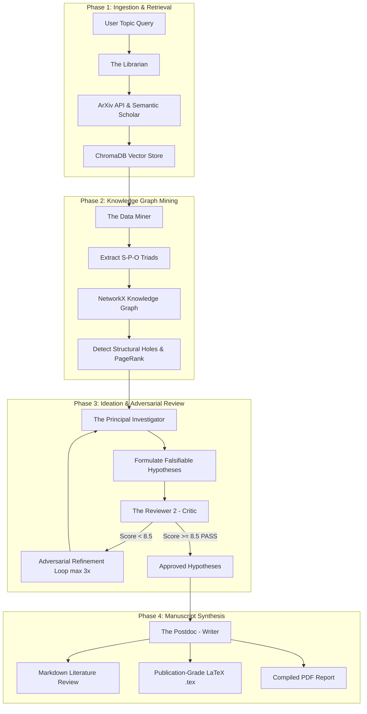

# 🔬 Multi-Agent AI Scientist
### Autonomous Literature Retrieval, Knowledge Graph Construction, Structural-Hole Ideation, Adversarial Peer Review & Manuscript Synthesis

<p align="center">
  
  
  
  
  
  
  
</p>

<p align="center">
  An end-to-end autonomous research engine that emulates a multidisciplinary academic lab. Five specialized agents collaborate across four sequential phases to ingest research papers, construct Subject-Predicate-Object knowledge graphs, discover structural holes across paradigms, iterate hypotheses via adversarial peer-review, and synthesize publication-ready LaTeX manuscripts.
</p>

---

## 📑 Table of Contents

- [Overview](#-overview)
- [Multi-Agent Topology & 4-Phase Pipeline](#-multi-agent-topology--4-phase-pipeline)
- [System Architecture](#-system-architecture)
- [Agent Specifications](#-agent-specifications)
- [Project Directory Structure](#-project-directory-structure)
- [Getting Started](#-getting-started)
  - [Prerequisites](#prerequisites)
  - [Installation](#installation)
  - [Environment Configuration](#environment-configuration)
- [Usage & Execution](#-usage--execution)
- [Output Artifacts](#-output-artifacts)
- [Testing](#-testing)
- [License](#-license)

---

## 🔍 Overview

Traditional literature reviews and hypothesis generation in scientific research are manual, time-consuming, and prone to domain-silo bias. **Multi-Agent AI Scientist** automates the end-to-end scientific workflow:
- **Retrieval & Ingestion**: Fetches from **ArXiv** and **Semantic Scholar** with dense vector chunking via **ChromaDB**.
- **Graph Mining**: Identifies Subject-Predicate-Object (S-P-O) triads and analyzes directed network topology using **NetworkX**.
- **Structural-Hole Ideation**: Applies Burt's Structural Hole theory to discover disconnected methods sharing clinical or empirical benchmarks.
- **Adversarial Critique**: Emulates stringent peer review ("Reviewer 2") requiring composite scores $\ge 8.5/10.0$ before approval.
- **Synthesis**: Compiles structured comparisons into Markdown, **LaTeX**, and compiled PDF formats.

---

## 🏗 Multi-Agent Topology & 4-Phase Pipeline



---

## 🤖 Agent Specifications

| # | Agent Name | Module | Primary Role & Capabilities |
| :-: | :--- | :--- | :--- |
| **1** | **The Librarian** | `agents/librarian.py` | Queries ArXiv & Semantic Scholar APIs, parses PDF text, performs recursive character chunking, and indexes dense vector embeddings into ChromaDB. |
| **2** | **The Data Miner** | `agents/miner.py` | Extracts methodologies, metrics, and Subject-Predicate-Object (S-P-O) triads; builds a directed NetworkX graph, computes PageRank centrality, and isolates structural holes. |
| **3** | **The Principal Investigator** | `agents/investigator.py` | Bridges topological gaps in the knowledge graph, queries the vector engine, and formulates 3 falsifiable hypotheses with mathematical objectives and ablation protocols. |
| **4** | **The Reviewer 2** | `agents/critic.py` | Audits hypotheses across a 4-pillar rubric (*Logical Soundness, Baseline Completeness, Computational Feasibility, Statistical Rigor*); enforces adversarial critique loops until score $\ge 8.5/10$. |
| **5** | **The Postdoc** | `agents/writer.py` | Compiles methodology matrices, structural hole visualizations, review logs, and hypotheses into publication-grade Markdown, LaTeX, and PDF manuscripts. |

---

## 📁 Project Directory Structure

```text
multi-agent-ai-scientist/
├── main.py                     # Entry point and 4-phase multi-agent orchestrator
├── requirements.txt            # crewai, langchain, chromadb, networkx, arxiv, pypdf, matplotlib
├── README.md                   # Project documentation
├── LICENSE                     # MIT License
├── .env.example                # Environment variables template
├── .gitignore                  # Git ignore rules
│
├── agents/                     # Specialized agent modules
│   ├── __init__.py
│   ├── librarian.py            # Agent 1: Retrieval & RAG ingestion
│   ├── miner.py                # Agent 2: S-P-O triad extraction & NetworkX KG
│   ├── investigator.py         # Agent 3: Structural-hole hypothesis ideation & refinement
│   ├── critic.py               # Agent 4: Adversarial Reviewer 2 rubric & critique loop
│   └── writer.py               # Agent 5: Markdown, LaTeX, and PDF manuscript synthesis
│
├── tools/                      # Core computational tools
│   ├── __init__.py
│   ├── arxiv_search.py         # ArXiv Atom API + Semantic Scholar API + PDF extractor
│   ├── rag_engine.py           # RecursiveCharacterTextSplitter + ChromaDB vector store
│   ├── kg_builder.py           # NetworkX DiGraph, structural hole finder & PNG exporter
│   ├── llm_client.py           # Model inference client (OpenRouter / Llama-3.3-70B)
│   └── manuscript_schema.py    # Pydantic schemas for manuscript & review validation
│
├── tests/                      # Testing suite
│   └── test_scientist.py       # Unit and end-to-end integration tests
│
└── output/                     # Generated reviews, Knowledge Graph plots, & LaTeX files
```

---

## 🚀 Getting Started

### Prerequisites

- **Python**: 3.10 or higher
- **LaTeX** (Optional, for PDF generation): `pdflatex` or MacTeX / TeX Live

### Installation

1. **Clone the repository:**
   ```bash
   git clone https://github.com/vedant-thakker/multi-agent-ai-scientist.git
   cd multi-agent-ai-scientist
   ```

2. **Create and activate a virtual environment:**
   ```bash
   python3 -m venv venv
   source venv/bin/activate  # On Windows: venv\Scripts\activate
   ```

3. **Install dependencies:**
   ```bash
   pip install --upgrade pip
   pip install -r requirements.txt
   ```

### Environment Configuration

Copy the example environment template and configure your API credentials:

```bash
cp .env.example .env
```

Edit `.env` with your API key:
```ini
OPENROUTER_API_KEY=your_openrouter_api_key_here
OPENROUTER_BASE_URL=https://openrouter.ai/api/v1
OPENROUTER_MODEL=meta-llama/llama-3.3-70b-instruct
```

---

## ⚡ Usage & Execution

Run the complete 4-phase autonomous scientific discovery pipeline:

```bash
python3 main.py --topic "Federated Learning in Healthcare" --max-papers 20 --max-iterations 3
```

### CLI Arguments

| Argument | Default | Description |
| :--- | :---: | :--- |
| `--topic` | Required | Scientific topic or research domain to investigate |
| `--max-papers` | `20` | Number of seminal papers to retrieve and index |
| `--max-iterations` | `3` | Maximum adversarial refinement loops with Reviewer 2 |

---

## 📊 Output Artifacts

All outputs are saved to the `output/` directory:
- **`knowledge_graph.png`**: High-resolution visualization of the NetworkX knowledge graph highlighting structural holes.
- **`knowledge_graph.json`**: Node-link graph data (methods, datasets, evaluation metrics).
- **`literature_review.md`**: Formatted Markdown synthesis with comparative lineage matrices.
- **`literature_review.tex`**: Complete, compilable LaTeX manuscript with IEEE / ACM citations.
- **`literature_review.pdf`**: Rendered PDF document ready for review.

---

## 🧪 Testing

Run the comprehensive unit and integration test suite:

```bash
pytest -v
```

---

## 📜 License

Distributed under the [MIT License](LICENSE).
